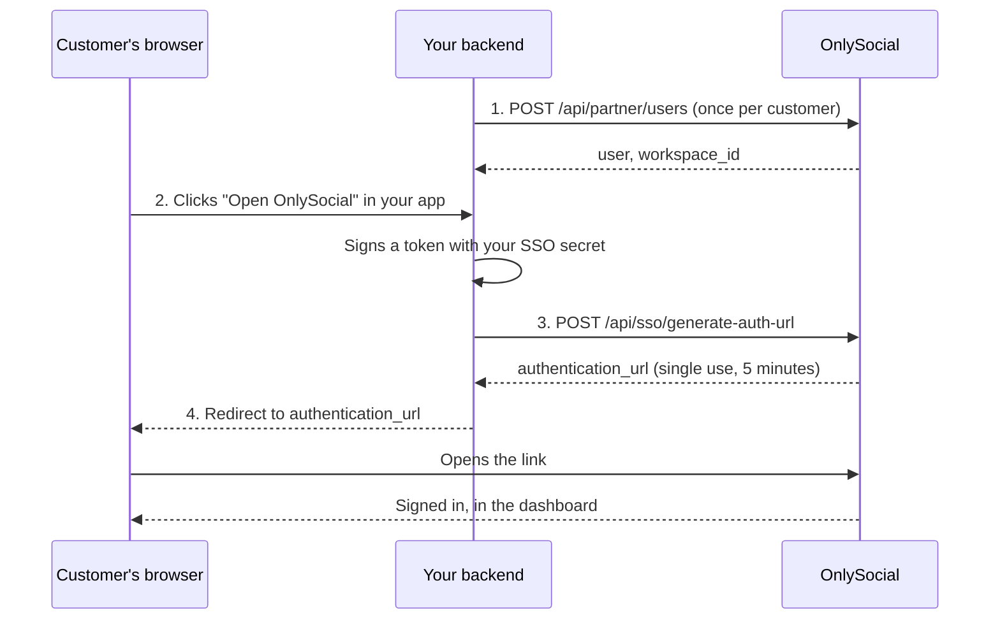

Single sign-on (SSO) lets a customer who is signed in to **your** app open OnlySocial without a password. Your backend vouches for them with a short-lived token signed with your SSO secret; OnlySocial swaps it for a one-time sign-in link, and you send their browser there.



## 1. Provision the customer

Create the account the first time you see a customer, and again whenever their name or e-mail changes in your app. The same request creates or refreshes, so it is safe to repeat.

```bash
curl -X POST https://app.onlysocial.io/api/partner/users \
  -H "X-API-KEY: $PARTNER_KEY" \
  -H "Content-Type: application/json" \
  -d '{
    "external_id": "dealer-4821",
    "email": "sales@acmemotors.test",
    "name": "Acme Motors"
  }'
```

| Field | | |
| --- | --- | --- |
| `external_id` | required | Your own id for the customer, up to 255 characters. Use something that never changes. |
| `email` | required | Their e-mail address. It must match the token you sign later. |
| `name` | optional | Shown in the dashboard. |

```json 200
{
  "success": true,
  "message": "User provisioned successfully.",
  "data": {
    "user_id": 184,
    "external_id": "dealer-4821",
    "email": "sales@acmemotors.test",
    "name": "Acme Motors",
    "created_at": "2026-10-20T09:12:04+00:00",
    "workspace_id": "6b1f0e2c-....",
    "workspace_ids": ["6b1f0e2c-...."],
    "outcome": "created",
    "workspace_created": true,
    "warnings": []
  }
}
```

A new customer gets their own workspace, ready to use. Keep `workspace_id`: it is what [workspace API keys](/partner/workspace-api-keys) and [Channel Connect](/partner/channel-connect) take.

### What `outcome` tells you

| `outcome` | `workspace_created` | What happened |
| --- | --- | --- |
| `created` | `true` | A new account, with a workspace of its own. |
| `updated` | `false` | A customer you had already provisioned, refreshed. This includes your own customer arriving under a new `external_id` (matched by e-mail): the new id is stamped on the account. |

`workspace_ids` lists every workspace the customer administers, oldest first, so `workspace_ids[0]` is always `workspace_id`. More than one appears if somebody later made them an admin of another workspace; pass the uuid you mean. A workspace they are only a member of is not listed.

<Warning>
If `warnings` contains `existing_account_linked_without_workspace`, the customer administers no workspace at the moment, and `workspace_id` is `null`. There is nothing to issue a key for or connect a channel in until somebody makes them an admin of a workspace.
</Warning>

`GET /api/partner/users/{external_id}` returns the same customer, with `is_active` and `last_sso_login`, or `404` for an `external_id` you have not provisioned.

### Conflicts

An e-mail address that already belongs to someone else is never taken over. You get a `409` with a stable `error_code`, and nothing is written:

| `error_code` | Meaning |
| --- | --- |
| `email_has_existing_account` | Someone opened an OnlySocial account with that e-mail themselves. It is never adopted, because that would let you sign in as them without their password. Ask the customer's workspace admin to invite that person, or provision a different e-mail. |
| `email_belongs_to_another_partner` | The e-mail is another partner's customer. The response says nothing about whose. |
| `email_in_use_by_another_account` | Your customer exists under that `external_id`, and the new e-mail you asked for is another account's. |

A `422` means a field failed validation (see `errors`). A `400` means the request was refused, for example an e-mail outside your allowed domains.

## 2. Sign a token

When the customer clicks through from your app, sign a JSON Web Token on your backend with **HS256** and your **SSO secret**.

| Claim | | |
| --- | --- | --- |
| `sub` | required | The customer's `external_id`. |
| `email` | required | Their e-mail. It must be the e-mail OnlySocial has for that `external_id`. |
| `name` | optional | Used only if the customer has not been provisioned yet. |
| `exp` | recommended | Expiry, as a Unix time. Keep it short: a minute is plenty. |
| `iat` | optional | Issued-at time. |

<CodeGroup>
```js Node.js
import jwt from 'jsonwebtoken';

const token = jwt.sign(
  { sub: customer.id, email: customer.email, name: customer.name },
  process.env.ONLYSOCIAL_SSO_SECRET,
  { algorithm: 'HS256', expiresIn: '60s' }
);
```

```php PHP
use Firebase\JWT\JWT;

$token = JWT::encode([
    'sub' => $customer->id,
    'email' => $customer->email,
    'name' => $customer->name,
    'iat' => time(),
    'exp' => time() + 60,
], getenv('ONLYSOCIAL_SSO_SECRET'), 'HS256');
```

```python Python
import time, jwt  # PyJWT

token = jwt.encode(
    {"sub": customer.id, "email": customer.email, "name": customer.name,
     "iat": int(time.time()), "exp": int(time.time()) + 60},
    os.environ["ONLYSOCIAL_SSO_SECRET"],
    algorithm="HS256",
)
```
</CodeGroup>

## 3. Exchange it for a sign-in link

```bash
curl -X POST https://app.onlysocial.io/api/sso/generate-auth-url \
  -H "Content-Type: application/json" \
  -d '{"token": "'"$TOKEN"'", "partner": "acme"}'
```

`partner` is your partner identifier. No partner key is sent: the signature is the proof.

```json 200
{
  "success": true,
  "data": {
    "authentication_url": "https://app.onlysocial.io/sso/authenticate?token=…",
    "expires_in": 300,
    "user": { "id": 184, "email": "sales@acmemotors.test", "name": "Acme Motors" }
  }
}
```

<Tip>
If the `sub` has never been provisioned, this call provisions the customer first, with the same rules and conflicts as step 1, and a workspace of their own. Provisioning up front is still worth it if you need the `workspace_id` before the customer's first visit.
</Tip>

## 4. Send the browser

Redirect the customer's browser to `authentication_url`. The link works **once**, within **5 minutes**, and leaves them signed in to OnlySocial.

To land somewhere other than the dashboard home, add `redirect`:

```
https://app.onlysocial.io/sso/authenticate?token=…&redirect=%2Fos%2F6b1f0e2c-....%2Fposts
```

That example opens the posts list of workspace `6b1f0e2c-…`. URL-encode the value.

`redirect` may be a path on `app.onlysocial.io`, or a full `https://` URL on `app.onlysocial.io` or on your own app's registered address. Anything else is ignored and the customer lands on the dashboard home.

If the link has expired or was already used, the customer sees the OnlySocial sign-in page with an error. Generate a fresh link each time someone clicks through; never store or share one.

## Errors from the exchange

| Status | `message` | Fix |
| --- | --- | --- |
| `400` | Missing required parameters: token and partner. | Send both. |
| `404` | Invalid or inactive SSO partner. | Check your partner identifier, or ask OnlySocial whether your account is active. |
| `400` | SSO token has expired. Please try again. | Sign a new token; check your server clock. |
| `400` | Invalid SSO token signature. | Sign with HS256 and the current SSO secret. |
| `400` | Missing required field: email | Add the `email` claim. |
| `400` | Email mismatch for external user ID. | The token's `email` differs from the one on file. Provision the new e-mail first (step 1), then sign in. |
| `400` | Email domain not allowed for this partner. | The address is outside your allowed domains. |
| `400` | That email address is already in use. | A conflict while provisioning a new `sub` on the fly. Call step 1 to see the `error_code`. |
| `429` | | More than 20 exchanges a minute from one address. |

Every provisioning call and sign-in, successful or not, is recorded in OnlySocial's SSO log for your partner account.
