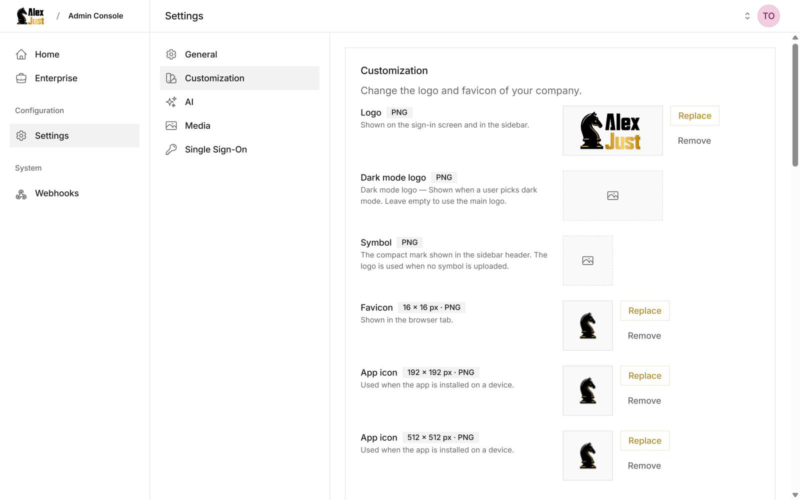

Your customers should only ever see your brand. Branding lives in **Admin Console > Settings > Customization**.

<Frame>
  
</Frame>

## Logo and icons

| Image | Size | Where it shows |
| --- | --- | --- |
| **Logo** | PNG | The sign-in screen and the sidebar |
| **Dark mode logo** | PNG | Instead of the logo when a user picks dark mode. Leave it empty to use the main logo. |
| **Symbol** | PNG | The compact mark in the sidebar header. Without one, the logo is used. |
| **Favicon** | 16 × 16 px PNG | The browser tab |
| **App icon** | 192 × 192 px and 512 × 512 px PNG | When a customer installs the app on a phone or computer |

Click **Replace** next to each image, choose the file, then click **Save**.

<Tip>
Use a PNG with a transparent background for the logo, so it sits well on light and dark themes.
</Tip>

## Theme

Below the images, **Themes** lists the built-in looks, from Sand and Classic to Midnight and Ocean. Click **Use** on one to make it what everyone sees, or click **New theme** to start from a built-in theme and change its colours to match your brand.

To let each customer pick a built-in theme for themselves, go to **Enterprise Console > Settings > System** and set **Allow users to choose their own theme** to **Yes**. Customers can choose a theme but never edit one.

## Other system settings

In **Enterprise Console > Settings > System** you also choose:

| Setting | What it does |
| --- | --- |
| **Allow users to create multiple workspaces** | Whether a customer can create more than one workspace, for example one per client or brand. |
| **Dedicated Twitter API for Workspace** | Whether each workspace connects X with its own developer app instead of yours. Add a link to your instructions in **URL to documentation**. |

## Your domain

Your platform runs at your own domain, such as `app.yourdomain.com`, set up for you by OnlySocial. To move it to a different domain, contact OnlySocial support before you change any DNS records.
