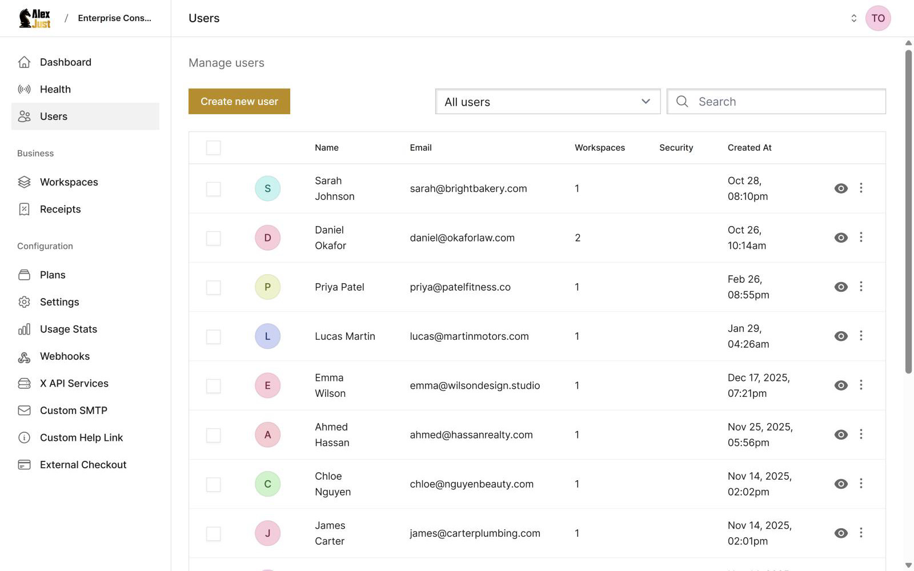
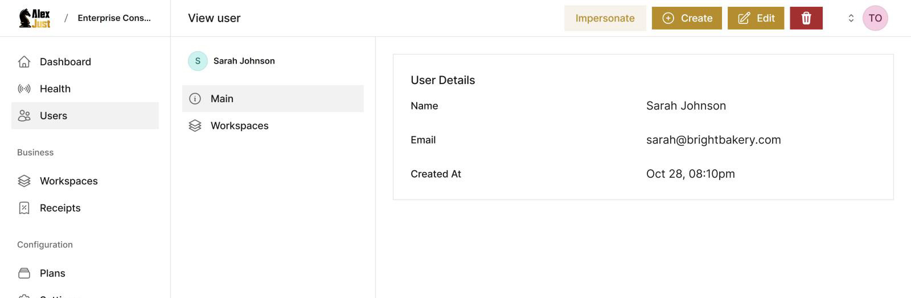
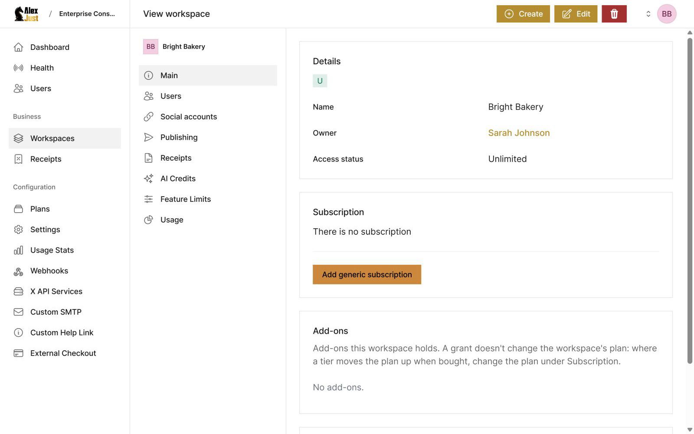
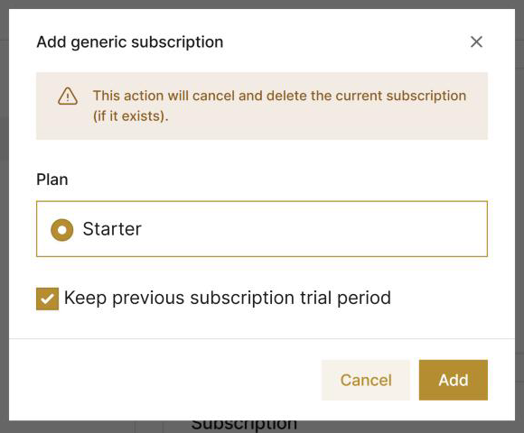

Every person who signs up is a **user**, and their work happens in **workspaces**. You manage both from the Enterprise Console.

## Users

**Enterprise Console > Users** lists everyone on your platform with their email address, how many workspaces they belong to, whether they use two-factor authentication, and when they joined.

<Frame>
  
</Frame>

Use the search box, or the filter next to it: **Unverified email**, **Has workspaces**, **Without a workspace**, **Has a subscription**, **On a trial**, **Two-factor authentication enabled** or **System admins**. **Create new user** adds an account yourself, for example for a customer you onboard by hand.

Click the eye icon on a row to open the user. **Main** shows their details and **Workspaces** lists every workspace they belong to, with its subscription and their role in it. From the buttons at the top you can **Edit** the user or delete them.

<Frame>
  
</Frame>

### Sign in as a customer

To see exactly what a customer sees, for example to help with a problem, click **Impersonate** on their page. You are signed in as them, and an **Impersonating** badge shows under the avatar at the top right.

To come back to your own account, open the user menu and click **Sign Out**. While you are impersonating, that ends the impersonation instead of signing you out.

<Warning>
While you impersonate a customer, everything you do is done as them: posts you publish and messages you send go out under their name. Look, fix what they asked for, and leave.
</Warning>

## Workspaces

**Enterprise Console > Workspaces** lists every workspace. Open one to see its tabs:

| Tab | What it shows |
| --- | --- |
| **Main** | The owner, access status, subscription and add-ons |
| **Users** | Members and their roles |
| **Social accounts** | Connected channels, and which are disconnected |
| **Publishing** | Published, scheduled, failed and draft posts, and its publishing failures of the last 90 days |
| **Receipts** | Its payments |
| **AI Credits** | Its AI credit balance and use |
| **Feature Limits** | The limits that apply to it |
| **Usage** | How much of each limit it has used |

<Frame>
  
</Frame>

### Give a workspace a plan

To put a workspace on a plan without a payment, for example a partner, a friend or a hidden plan for a custom deal:

<Steps>
  <Step title="Open the workspace">
    In **Enterprise Console > Workspaces**, open the workspace.
  </Step>
  <Step title="Add a generic subscription">
    Under **Subscription**, click **Add generic subscription**.
  </Step>
  <Step title="Choose the plan">
    Pick the plan. Leave **Keep previous subscription trial period** ticked to keep any trial the workspace still has, then click **Add**.
  </Step>
</Steps>

<Frame>
  
</Frame>

<Warning>
Adding a generic subscription cancels and deletes the workspace's current subscription, including a paid one. Cancel the customer's payments on your payment platform as well if they should stop paying.
</Warning>

**Add-ons** on the same page lists the extras the workspace holds. An add-on doesn't change the workspace's plan: to move a workspace to a bigger plan, change it under **Subscription**.

## Keep an eye on the platform

- **Dashboard.** Revenue (MRR, ARR, the last 30 days), paying customers, trials, past-due and cancelling subscriptions, and customers by plan.
- **Health.** Publishing failures by network, the most frequent errors, and disconnected social accounts across every workspace. Check it to spot a network having trouble before customers report it.
- **Receipts.** Every payment on the platform.
