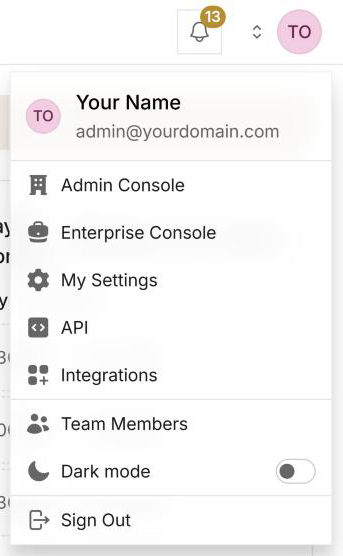
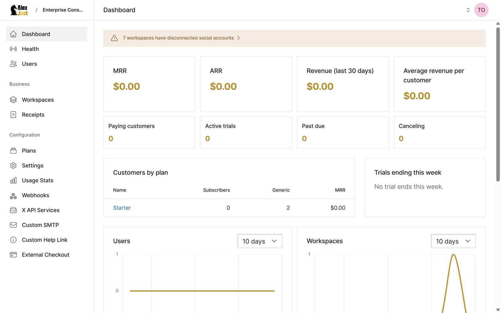

Your whitelabel is your own social media platform, running on your domain with your brand. This guide uses `app.yourdomain.com` for that address: replace it with yours.

## Sign in

<Steps>
  <Step title="Open your platform">
    Go to `https://app.yourdomain.com/os/login`.
  </Step>
  <Step title="Set your password">
    Your admin account uses the email address OnlySocial sent you. The first time, choose a password at `https://app.yourdomain.com/os/forgot-password`: enter that email address and follow the link in the message you receive.
  </Step>
  <Step title="Sign in">
    Sign in with your email address and new password. You land in your own workspace, like any customer.
  </Step>
</Steps>

## Your admin menus

As the platform admin you have two extra items in the user menu, at the top right:

<Frame>
  
</Frame>

| Menu item | What you do there |
| --- | --- |
| **Enterprise Console** | Run the business: customers and their workspaces, plans and prices, payments, sign-up, email, your help link and the X API. |
| **Admin Console** | Shape the product: your logo, favicon and theme, AI and media settings, and system webhooks. |

The Enterprise Console opens on a dashboard of your revenue (MRR, ARR, the last 30 days), paying customers, trials, and sign-ups over time:

<Frame>
  
</Frame>

## Set up checklist

Work through these before you invite customers:

<Steps>
  <Step title="Brand the platform">
    Upload your logo and favicon and pick a theme. See [Brand your platform](/whitelabel/branding).
  </Step>
  <Step title="Connect a payment platform">
    Connect Stripe and choose your currency, billing cycle and trial. See [Take payments](/whitelabel/payments).
  </Step>
  <Step title="Create your plans">
    Set prices and limits for each plan. See [Create plans](/whitelabel/plans).
  </Step>
  <Step title="Set up sign-up and email">
    Decide who can register, add your terms, and send email from your own address. See [Sign-up, email and help](/whitelabel/sign-up-and-email).
  </Step>
  <Step title="Connect the X API (optional)">
    Needed only if your customers will post to X. See [Connect the X API](/whitelabel/x-api).
  </Step>
  <Step title="Test as a customer">
    Register a test account from a private browser window, subscribe to a plan, connect a channel and schedule a post. Then look it up under **Enterprise Console > Users**. See [Manage customers](/whitelabel/customers).
  </Step>
</Steps>

## Help for you and your customers

- **Your customers' help centre.** Set a [custom help link](/whitelabel/sign-up-and-email#help-link) to send customers from the sidebar to your own help centre.
- **API documentation.** Open **API** in the user menu and click **API documentation** for unbranded API docs you can share with customers. Every API on this site works the same on your whitelabel, at `app.yourdomain.com`.
- **Support.** For anything about your platform itself, such as your domain, your server or a feature that should be switched on, contact OnlySocial support or visit [help.onlysocial.io](https://help.onlysocial.io).
