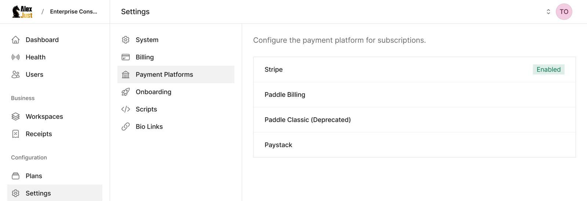
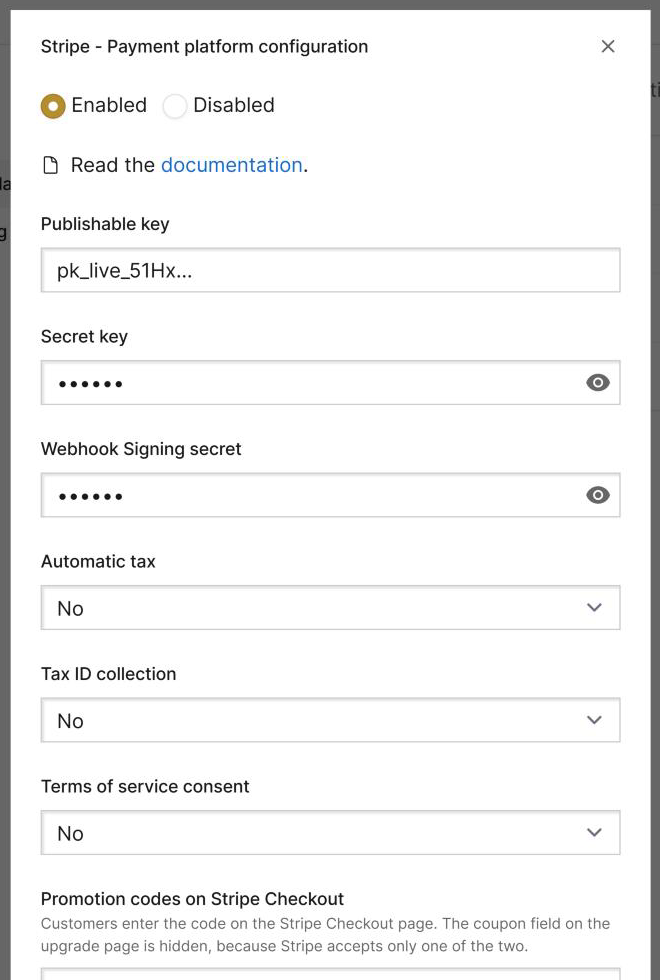
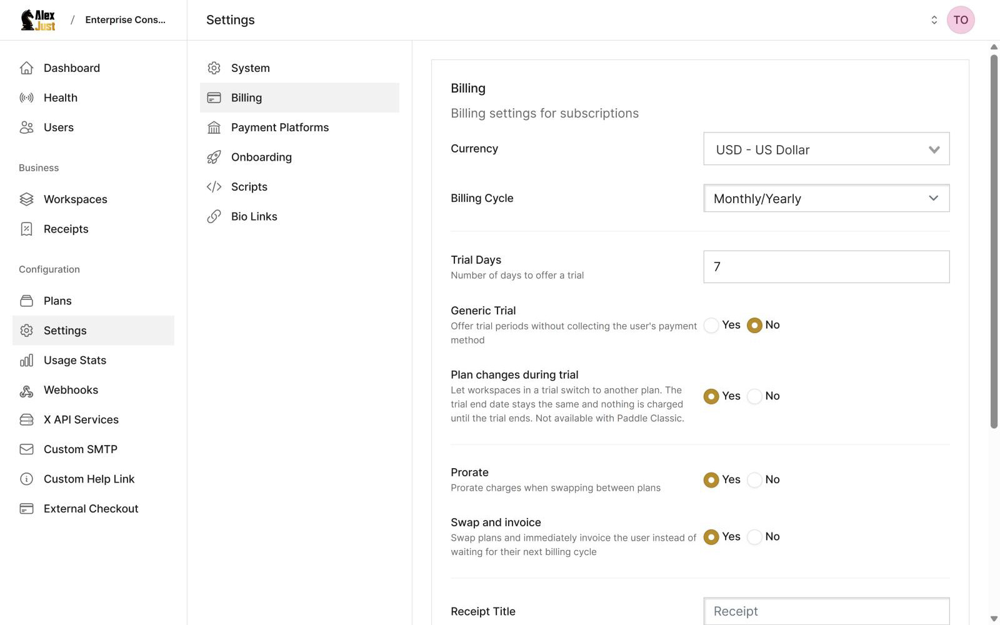

Customers pay you directly, through your own payment platform account. Payments live in **Enterprise Console > Settings**: **Payment Platforms** connects the account, and **Billing** sets how subscriptions work.

## Choose a payment platform

**Payment Platforms** lists the platforms you can connect: **Stripe**, **Paddle Billing** and **Paystack**. Paddle Classic is listed too but deprecated: don't start new subscriptions on it. The platform you connect shows **Enabled**.

<Frame>
  
</Frame>

The steps below are for Stripe, the most common choice.

## Connect Stripe

<Steps>
  <Step title="Copy your API keys">
    In your [Stripe Dashboard](https://dashboard.stripe.com/apikeys), open **Developers > API keys** and copy the **Publishable key** (`pk_live_…`) and the **Secret key** (`sk_live_…`).
  </Step>
  <Step title="Add a webhook endpoint">
    In Stripe, open **Developers > Webhooks** and add an endpoint with this URL:

    ```
    https://app.yourdomain.com/os/payment-webhook
    ```

    Select these events:

    | Event | Why |
    | --- | --- |
    | `customer.subscription.created` | A customer subscribed |
    | `customer.subscription.updated` | A plan changed, a trial ended or a renewal date moved |
    | `customer.subscription.deleted` | A subscription ended |
    | `invoice.payment_succeeded` | A payment went through, so a receipt is created |
    | `invoice.payment_failed` | A payment failed |
    | `customer.updated` | The customer's details changed in Stripe |
    | `customer.deleted` | The customer was deleted in Stripe |
    | `payment_method.automatically_updated` | The card network updated a saved card |

    After you save the endpoint, reveal and copy its **Signing secret** (`whsec_…`).
  </Step>
  <Step title="Enter the keys">
    In **Enterprise Console > Settings > Payment Platforms**, click **Stripe**, choose **Enabled**, and paste the **Publishable key**, **Secret key** and **Webhook Signing secret**.

    <Frame>
      
    </Frame>
  </Step>
  <Step title="Choose the checkout options and save">
    | Option | What it does |
    | --- | --- |
    | **Automatic tax** | Stripe Tax works out and adds sales tax or VAT. Set Stripe Tax up in Stripe first. |
    | **Tax ID collection** | Business customers can enter a VAT or tax ID at checkout. |
    | **Terms of service consent** | Customers must tick your terms at checkout. Set your terms URL in Stripe first. |
    | **Promotion codes on Stripe Checkout** | Customers enter coupon codes on the Stripe Checkout page. The coupon field on your upgrade page is then hidden, because Stripe accepts only one of the two. |
    | **Use Stripe invoice PDF** | Customers get Stripe's invoice PDF instead of your platform's receipt. |

    Click **Save**.
  </Step>
</Steps>

<Tip>
Test the whole flow with Stripe's test keys (`pk_test_…` and `sk_test_…`) and a test-mode webhook first. Switch to the live keys before your first real customer signs up.
</Tip>

Each paid plan then needs the IDs of its Stripe prices. See [Create plans](/whitelabel/plans#prices).

## Billing settings

**Enterprise Console > Settings > Billing** decides how subscriptions behave on any payment platform:

<Frame>
  
</Frame>

| Setting | What it does |
| --- | --- |
| **Currency** | The currency of every plan price. It must match the currency of your Stripe prices. |
| **Billing Cycle** | Offer **Monthly/Yearly**, **Monthly only** or **Yearly only**. |
| **Trial Days** | How many days of free trial a new subscription starts with. |
| **Generic Trial** | Start trials without asking for a card. Customers add one when the trial ends. |
| **Plan changes during trial** | Let a workspace on a trial switch plan. The trial end date stays the same and nothing is charged until it ends. |
| **Prorate** | Charge or credit the difference when a customer changes plan mid-cycle. |
| **Swap and invoice** | Invoice a plan change straight away instead of at the next renewal. |
| **Receipt Title** and **Company details** | The title and the business details (name, address, tax number) printed on receipts. |
| **Plans Page URL** and **Plans Page URL title** | A link to your public pricing page, shown to customers choosing a plan. |

Click **Save** at the bottom of the page.
