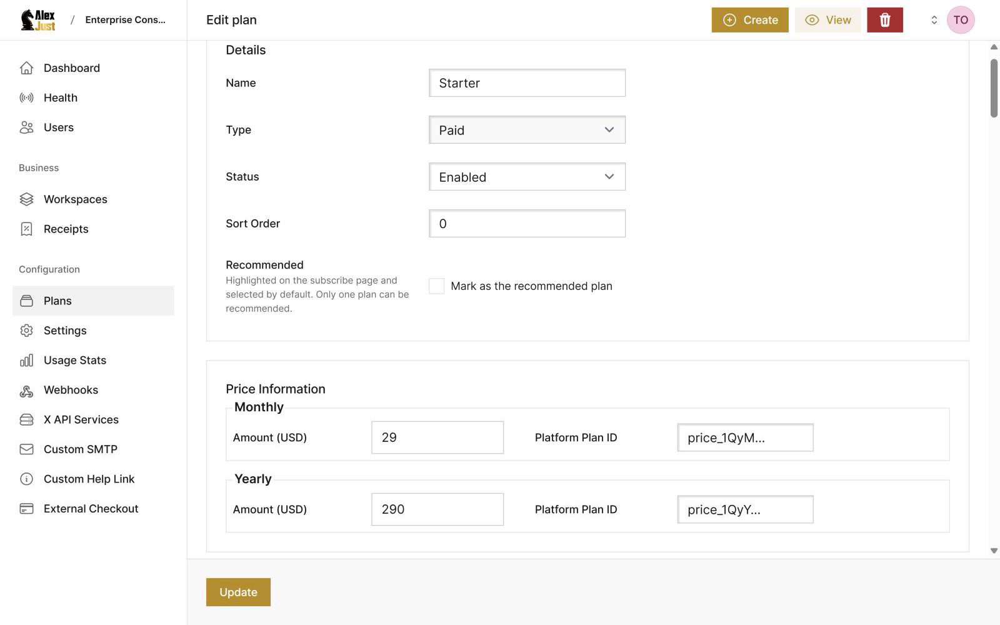
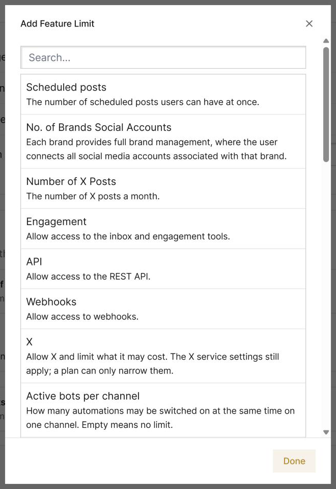
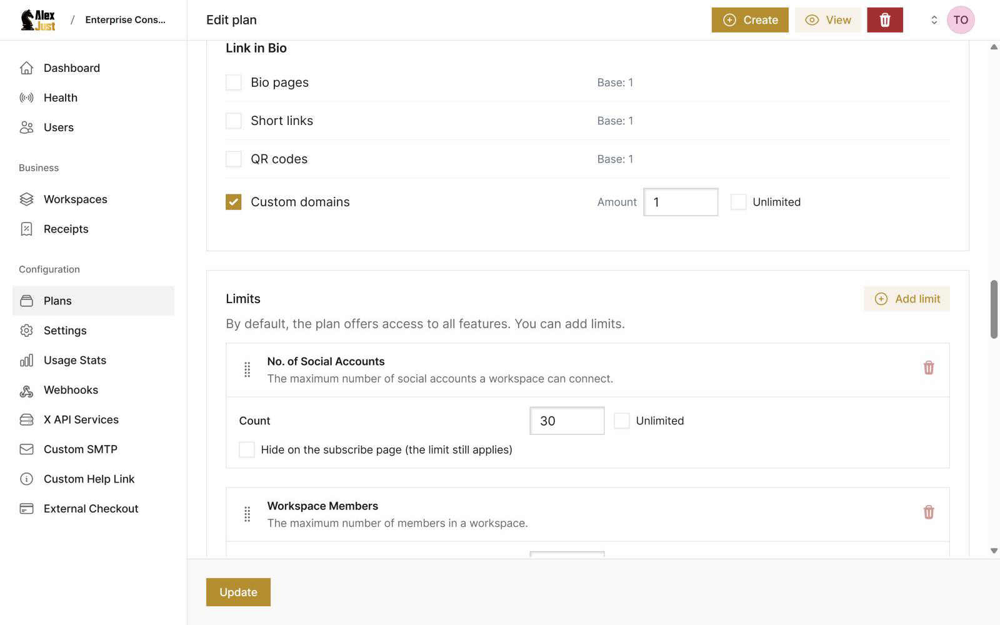

Plans are what your customers subscribe to. Each plan has a price, decides which modules a workspace gets, and caps how much it can use. Manage them in **Enterprise Console > Plans**.

## Create a plan

Click **Create plan** and fill in the sections from top to bottom.

<Frame>
  
</Frame>

### Details

| Field | What it does |
| --- | --- |
| **Name** | What customers see, for example `Starter`. |
| **Type** | **Free** or **Paid**. Paid plans show the price fields. |
| **Status** | **Enabled** plans can be subscribed to. Disable a plan to stop offering it. |
| **Sort Order** | The plan's position on the plans page, lowest first. |
| **Recommended** | Highlights the plan on the subscribe page and selects it by default. Only one plan can be recommended. |

### Prices

For a paid plan, enter the **Amount** for each billing cycle you offer, monthly and yearly, in the currency from your [billing settings](/whitelabel/payments#billing-settings).

Each amount also needs a **Platform Plan ID**: the ID of the matching price on your payment platform. In Stripe:

<Steps>
  <Step title="Create a product">
    In Stripe, open **Product catalog**, click **Add product** and name it after the plan.
  </Step>
  <Step title="Add a recurring price per cycle">
    Add a monthly recurring price and a yearly recurring price, with the same amounts and currency as the plan.
  </Step>
  <Step title="Copy the price IDs">
    Copy each price's ID (`price_…`) into the plan's matching **Platform Plan ID**.
  </Step>
</Steps>

<Warning>
The amount you type in the plan is only for display. Stripe charges the amount of the price whose ID you entered, so keep the two the same.
</Warning>

### Visibility

**Display Status** decides whether the plan appears on the plans page. Make a plan **Hidden** to keep it for customers you set up yourself, such as a custom deal, and give it to them with a [generic subscription](/whitelabel/customers#give-a-workspace-a-plan).

### Plan type and modules

**Plan type** is **Standard plan** for a normal subscription, or **Add-on** for an extra that customers buy on top of a plan. You can't change it after the plan is created.

**Modules** decides which parts of the product the plan includes:

| Choice | Use it for |
| --- | --- |
| **Everything, no limits** | Every module, every count unlimited, and no add-ons offered. For monthly plans that need no Salesbot limits. |
| **Choose modules** | Exactly the modules you tick, such as Salesbot per channel, Flow Builder, broadcasts, integrations and Link in Bio. A module that isn't ticked isn't included. For lifetime plans, and monthly plans with their own Salesbot limits. |

A plan that makes neither choice gets the base allowance shown next to each module.

## Set limits

Under **Limits**, click **Add limit** and pick what to cap. Without limits, a plan offers every feature without restriction.

<Frame>
  
</Frame>

Each limit you add appears as a card where you enter its value. Tick **Unlimited** to remove the cap, or **Hide on the subscribe page** to keep the limit without listing it.

<Frame>
  
</Frame>

The limits you will use most:

| Limit | What it caps |
| --- | --- |
| **Scheduled posts** | Scheduled posts a workspace can have at once |
| **No. of Social Accounts** | Social accounts a workspace can connect |
| **No. of Brands Social Accounts** | Brands a workspace can manage. A brand is one profile on each network, so 2 brands allows two profiles per network. |
| **Workspace Members** | Members in a workspace |
| **Workspace Storage** | Media storage per workspace, in MB |
| **AI Credits** | AI credits each month. They renew on the billing day, on monthly and yearly plans alike. |
| **AI Image Credits** | Images the AI can generate. One image costs one credit. |
| **Number of X Posts** | X posts a month |
| **Contacts** | Contacts a workspace can add by hand or by import. Messages from new customers are always received. |
| **Engagement**, **API**, **Webhooks**, **MCP** | Whether the plan includes the inbox, the REST API, webhooks and AI assistants |

<Warning>
Always set limits for **Workspace Storage**, **AI Credits**, **AI Image Credits** and **Number of X Posts**. Left unlimited, a single busy workspace can drive up your storage, AI and X API costs.
</Warning>

Click **Create** at the bottom of the page. To change a plan later, open it from **Plans** and click **Edit**. Limit changes apply to every workspace on the plan. A new price only reaches existing subscribers if you also move them to the new Stripe price.
