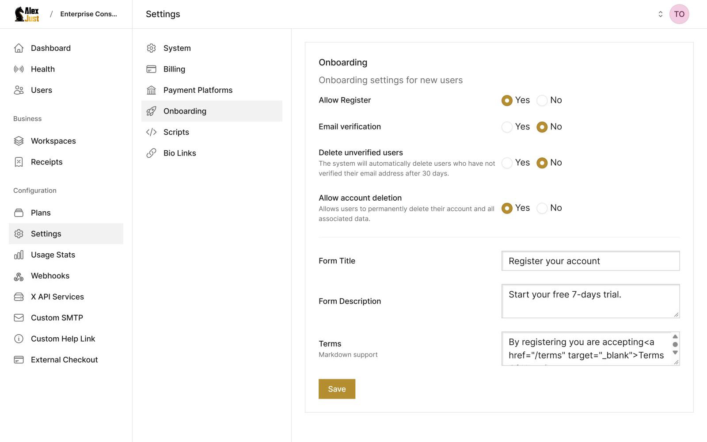
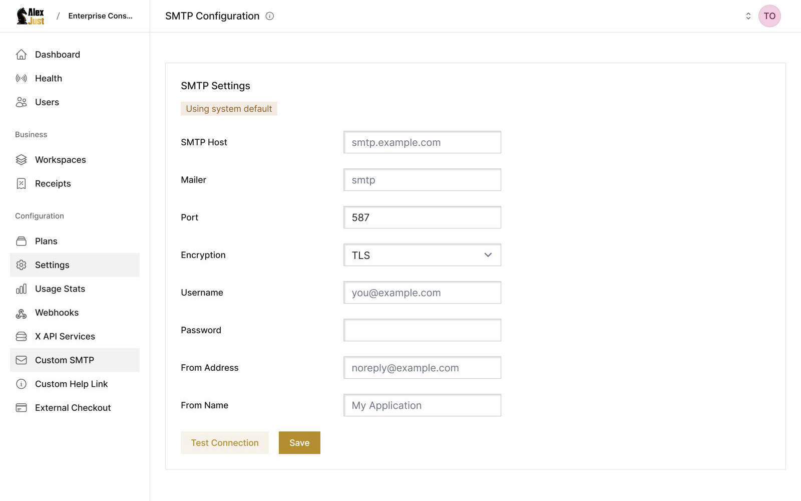
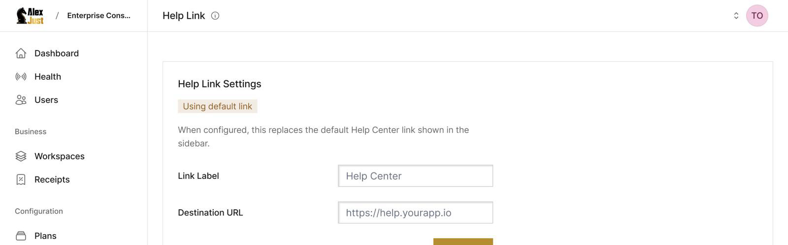

## Sign-up

**Enterprise Console > Settings > Onboarding** controls how new customers join.

<Frame>
  
</Frame>

| Setting | What it does |
| --- | --- |
| **Allow Register** | Anyone can create an account at `https://app.yourdomain.com/os/register`. Set it to **No** to add every account yourself under **Users**. |
| **Email verification** | New customers must confirm their email address before they can use the app. |
| **Delete unverified users** | Accounts that never confirmed their email address are deleted after 30 days. |
| **Allow account deletion** | Customers can permanently delete their own account and all its data. |
| **Form Title** and **Form Description** | The heading and text above the registration form, for example "Start your free 7-day trial". |
| **Terms** | The line under the form about your terms and privacy policy. Markdown is supported, so you can link to your own pages. |

Click **Save**.

<Tip>
Turn on **Email verification** once [your own SMTP](#email) is working. It keeps fake sign-ups out of your customer list and your trials.
</Tip>

## Email

By default, your platform sends email, such as password resets, invitations and verification links, through the system mail server. To send it from your own address and domain, set up your mail provider in **Enterprise Console > Custom SMTP**.

<Frame>
  
</Frame>

<Steps>
  <Step title="Enter your provider's details">
    Copy the **SMTP Host**, **Port**, **Encryption**, **Username** and **Password** from your mail provider, such as Google Workspace, Microsoft 365, Amazon SES, Postmark or Mailgun. Leave **Mailer** as `smtp`.
  </Step>
  <Step title="Set the sender">
    Enter the **From Address**, for example `hello@yourdomain.com`, and the **From Name**, usually your brand.
  </Step>
  <Step title="Test and save">
    Click **Test Connection**. When it succeeds, click **Save**. Until you save your own server, the page shows **Using system default**.
  </Step>
</Steps>

<Note>
Most providers only send from a domain you have verified with them. Add the SPF and DKIM records they give you to your domain's DNS, so your email reaches inboxes instead of spam.
</Note>

## Help link

The sidebar shows customers a **Help Center** link. Until you set your own, it opens the platform's whitelabel help centre: an unbranded guide to every feature that never mentions OnlySocial, so you don't have to write one. The page shows **Using default link** while that's the case.

To point the link at your own help centre instead, go to **Enterprise Console > Custom Help Link**.

<Frame>
  
</Frame>

Enter the **Link Label**, for example `Help Center`, and the **Destination URL**, then click **Save Link**.
