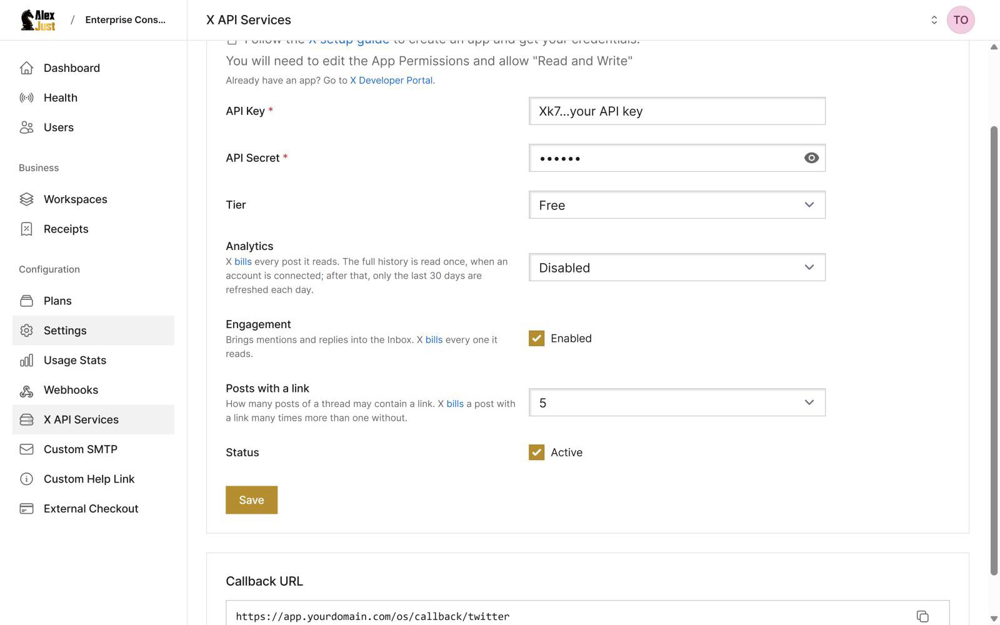

X charges for every use of its API, so your platform posts to X through your own X developer app and the bill goes to your X account.

## Create an X app

<Steps>
  <Step title="Open the X Developer Portal">
    Sign in at [developer.x.com](https://developer.x.com) with the X account that should own the app, and create a project and an app.
  </Step>
  <Step title="Set the app's permissions">
    In the app's **User authentication settings**, set **App permissions** to **Read and write**, and **Type of App** to **Web App**.
  </Step>
  <Step title="Add your callback URL">
    Under **Callback URI / Redirect URL**, enter:

    ```
    https://app.yourdomain.com/os/callback/twitter
    ```

    For **Website URL**, enter `https://app.yourdomain.com`. Save.
  </Step>
  <Step title="Copy the keys">
    Under **Keys and tokens**, copy the **API Key** and **API Key Secret** (the consumer keys).
  </Step>
</Steps>

## Connect it to your platform

Go to **Enterprise Console > X API Services**, paste the **API Key** and **API Secret**, choose your settings, tick **Status: Active** and click **Save**. The **Callback URL** box at the bottom shows the exact URL your X app needs.

<Frame>
  
</Frame>

| Setting | What it does |
| --- | --- |
| **Tier** | Your X API plan. **Pay as you go** is recommended. |
| **Analytics** | How far back X post analytics are read: **Full history**, **Last 30 days**, **Last 7 days** or **Disabled**. X bills every post it reads. The history is read once when an account is connected; after that, only the last 30 days are refreshed each day. |
| **Engagement** | Brings X mentions and replies into the inbox. X bills every one it reads. |
| **Posts with a link** | How many posts of a thread may contain a link. X bills a post with a link many times more than one without. |

<Tip>
To keep X costs predictable, start with **Analytics** on **Last 7 days** and limit links per thread. Then cap X posts per plan with the **Number of X Posts** limit in [Create plans](/whitelabel/plans#set-limits).
</Tip>
